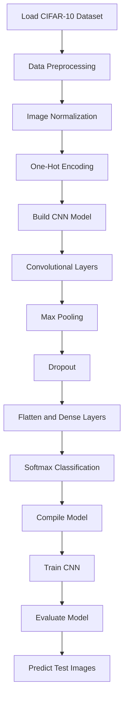

# EX.NO.5 – BUILDING AND TRAINING A CNN

## AIM

To build and train a Convolutional Neural Network (CNN) using TensorFlow and Keras to classify images into ten different categories using the CIFAR-10 dataset.

## INTRODUCTION

A Convolutional Neural Network (CNN) is a deep learning algorithm widely used for image recognition and classification. It automatically extracts important features from images using convolutional and pooling layers.

CNNs are commonly used in computer vision applications such as object detection, face recognition, medical image analysis, and autonomous vehicles.

In this experiment, a CNN model is developed and trained using the CIFAR-10 dataset to recognize objects belonging to ten different categories.

## DATASET DESCRIPTION

The CIFAR-10 dataset is a widely used image classification dataset containing 60,000 color images of size 32 × 32 pixels.

**Dataset Details:**

- Training Images: 50,000
- Testing Images: 10,000
- Image Size: 32 × 32 pixels
- Color Channels: 3 (RGB)
- Number of Classes: 10

**The ten classes are:**

1. Airplane
2. Automobile
3. Bird
4. Cat
5. Deer
6. Dog
7. Frog
8. Horse
9. Ship
10. Truck

## PROCEDURE

### STEP 1: IMPORT LIBRARIES

Import the required libraries and modules for building and training the CNN model.

- TensorFlow and Keras are used to build and train the CNN.
- Matplotlib is used for image visualization and plotting graphs.
- NumPy is used for numerical operations.
- to_categorical is used for one-hot encoding of class labels.

```python
import tensorflow as tf
from tensorflow.keras import datasets, layers, models
from tensorflow.keras.utils import to_categorical
import matplotlib.pyplot as plt
import numpy as np
```

### STEP 2: LOAD CIFAR-10 DATASET

The CIFAR-10 dataset is loaded using the Keras datasets module.

- Training Set: 50,000 images
- Testing Set: 10,000 images

```python
(X_train, y_train), (X_test, y_test) = datasets.cifar10.load_data()
```

### STEP 3: PREPROCESS DATA

Data preprocessing is performed to prepare the images for CNN training.

**Normalization:**

Pixel values are converted from the range 0–255 to the range 0–1. This improves training stability and convergence.

**One-Hot Encoding:**

Converts class labels into 10-dimensional binary vectors for multiclass classification.

```python
X_train = X_train.astype('float32') / 255.0
X_test = X_test.astype('float32') / 255.0

y_train = to_categorical(y_train, 10)
y_test = to_categorical(y_test, 10)
```

### STEP 4: VISUALIZE SAMPLE IMAGES

Displays a 4 × 4 grid of sample images from the training dataset with their corresponding class names.

```python
class_names = [
    'Airplane', 'Automobile', 'Bird', 'Cat', 'Deer',
    'Dog', 'Frog', 'Horse', 'Ship', 'Truck'
]

plt.figure(figsize=(10,10))

for i in range(16):
    plt.subplot(4,4,i+1)
    plt.xticks([])
    plt.yticks([])
    plt.grid(False)
    plt.imshow(X_train[i])
    plt.title(class_names[np.argmax(y_train[i])])

plt.show()
```

### STEP 5: BUILD THE CNN MODEL

A Sequential CNN model is created using convolutional, pooling, dropout, and dense layers.

**Layers Used:**

1. **Convolutional Layer:** Extracts important features such as edges, shapes, and patterns from images.
2. **ReLU Activation:** Introduces non-linearity into the network.
3. **MaxPooling Layer:** Reduces the spatial dimensions of feature maps.
4. **Dropout Layer:** Helps prevent overfitting by randomly disabling neurons during training.
5. **Flatten Layer:** Converts multidimensional feature maps into a one-dimensional vector.
6. **Dense Layer:** Performs classification using extracted features.
7. **Softmax Layer:** Produces probability scores for the ten CIFAR-10 classes.

```python
model = models.Sequential()

model.add(layers.Conv2D(
    32, (3,3),
    activation='relu',
    padding='same',
    input_shape=(32,32,3)
))

model.add(layers.Conv2D(
    32, (3,3),
    activation='relu',
    padding='same'
))

model.add(layers.MaxPooling2D((2,2)))
model.add(layers.Dropout(0.25))

model.add(layers.Conv2D(
    64, (3,3),
    activation='relu',
    padding='same'
))

model.add(layers.Conv2D(
    64, (3,3),
    activation='relu',
    padding='same'
))

model.add(layers.MaxPooling2D((2,2)))
model.add(layers.Dropout(0.25))

model.add(layers.Conv2D(
    128, (3,3),
    activation='relu',
    padding='same'
))

model.add(layers.Conv2D(
    128, (3,3),
    activation='relu',
    padding='same'
))

model.add(layers.MaxPooling2D((2,2)))
model.add(layers.Dropout(0.25))

model.add(layers.Flatten())

model.add(layers.Dense(512, activation='relu'))
model.add(layers.Dropout(0.5))

model.add(layers.Dense(10, activation='softmax'))
```

### STEP 6: COMPILE THE MODEL

The CNN model is compiled using the Adam optimizer and categorical cross-entropy loss function.

- **Optimizer – Adam:** Provides efficient and stable weight updates.
- **Loss Function – Categorical Cross-Entropy:** Measures the difference between actual and predicted class probabilities.
- **Metrics – Accuracy:** Measures the percentage of correctly classified images.

```python
model.compile(
    optimizer='adam',
    loss='categorical_crossentropy',
    metrics=['accuracy']
)

model.summary()
```

### STEP 7: TRAIN THE MODEL

The CNN model is trained using the training dataset.

**Training Parameters:**

- Epochs: 30
- Batch Size: 64
- Validation Split: 0.2 (20%)
- Optimizer: Adam

The history object stores training and validation accuracy and loss values for visualization.

```python
history = model.fit(
    X_train,
    y_train,
    epochs=30,
    batch_size=64,
    validation_split=0.2
)
```

### STEP 8: PLOT TRAINING HISTORY

Training and validation accuracy and loss graphs are plotted to analyze the model's learning performance.

```python
plt.figure(figsize=(12,5))

# Accuracy Graph
plt.subplot(1,2,1)

plt.plot(
    history.history['accuracy'],
    label='Train Accuracy'
)

plt.plot(
    history.history['val_accuracy'],
    label='Validation Accuracy'
)

plt.title('Model Accuracy')
plt.xlabel('Epoch')
plt.ylabel('Accuracy')
plt.legend()

# Loss Graph
plt.subplot(1,2,2)

plt.plot(
    history.history['loss'],
    label='Train Loss'
)

plt.plot(
    history.history['val_loss'],
    label='Validation Loss'
)

plt.title('Model Loss')
plt.xlabel('Epoch')
plt.ylabel('Loss')
plt.legend()

plt.show()
```

### MODEL ACCURACY GRAPH

- Training accuracy increases with each epoch, indicating that the model is learning patterns from the training data.
- Validation accuracy shows how well the model performs on unseen validation images.
- A small difference between training and validation accuracy indicates better generalization.
- A large difference may indicate overfitting.

### MODEL LOSS GRAPH

- Training loss generally decreases as the model learns.
- Validation loss indicates how well the model performs on unseen data.
- A decreasing loss indicates improvement in prediction performance.
- Fluctuations in validation loss may indicate overfitting or stabilization of learning.

### STEP 9: EVALUATE THE MODEL

The trained CNN model is evaluated using the test dataset to measure its performance on unseen images.

```python
test_loss, test_accuracy = model.evaluate(
    X_test,
    y_test
)

print("Test Loss:", test_loss)
print("Test Accuracy:", test_accuracy)
```

### STEP 10: PREDICT ON TEST IMAGES

The trained model predicts the class of test images using the predict() function.

The predicted class is compared with the actual class to check the classification performance.

```python
def plot_predictions(index):

    img = X_test[index]

    true_label = class_names[
        np.argmax(y_test[index])
    ]

    pred_probs = model.predict(
        np.expand_dims(img, axis=0),
        verbose=0
    )

    pred_label = class_names[
        np.argmax(pred_probs)
    ]

    plt.imshow(img)

    plt.title(
        f"True: {true_label} | Pred: {pred_label}"
    )

    plt.axis('off')
    plt.show()


for i in range(5):
    plot_predictions(i)
```

## CNN WORKING FLOWCHART



## OUTPUT SCREENSHOTS

### 1. Model Training Output


### 2. Sample CIFAR-10 Images


### 3. CNN Model Summary


### 4. Model Training Accuracy and Loss


### 5. Model Accuracy Visualization


### 6. Model Loss Visualization


### 7. Image Prediction Output


## RESULT

Thus, a Convolutional Neural Network (CNN) was successfully built and trained using TensorFlow and Keras with the CIFAR-10 dataset. The model learned image features through convolutional and pooling layers and performed multiclass image classification across ten different categories. Training accuracy, validation accuracy, loss graphs, and image predictions were analyzed successfully.

## CONCLUSION

The experiment demonstrates the application of deep learning and Convolutional Neural Networks in image classification. The working of convolutional layers, pooling layers, dropout, dense layers, and softmax activation was understood. The trained CNN model successfully performed object recognition using the CIFAR-10 dataset.
